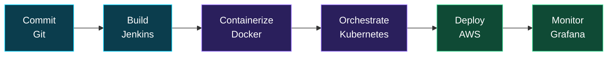

<!-- Header -->

 

---

## 👋 About Me

Computer Science student and aspiring **DevOps & Cloud Engineer** from Islamabad, Pakistan 🇵🇰. I focus on bridging the gap between development and operations: automating software delivery, building reliable cloud infrastructure and making deployments repeatable.

- 🌱 Currently learning **AWS**, **Terraform** and **Kubernetes** in depth
- 🔭 Building hands-on projects around **CI/CD**, **containers** and **Infrastructure as Code**
- 🤝 Looking to collaborate on **cloud-native projects**
- 🎓 Open to **entry-level DevOps roles and internships**
- 💬 Ask me about **DevOps, Docker, Linux and CI/CD**
- 📫 Reach me at **[atifkhan97401@gmail.com](mailto:atifkhan97401@gmail.com)**

---

## 🔄 How I Think About Delivery

---

## 🛠️ Tech Stack

**☁️ Cloud & Infrastructure**

**⚙️ Containers & Orchestration**

**🚀 CI/CD & Version Control**

**🐧 OS & Scripting**

**📊 Monitoring**

**🌐 Web (side skills)**

---

## 📌 Featured Projects

> Replace these with your own repositories. Describe each in one line: what it does and which tools it uses.

| Project | What it does | Tech |
|---|---|---|
| 🔗 [**project-name-1**](https://github.com/Atifullah2451) | CI/CD pipeline that builds a Docker image and deploys on every push | `Jenkins` `Docker` `AWS` |
| 🔗 [**project-name-2**](https://github.com/Atifullah2451) | AWS infrastructure (VPC, EC2, S3) provisioned as code | `Terraform` `AWS` |
| 🔗 [**project-name-3**](https://github.com/Atifullah2451) | Containerized app deployed to a Kubernetes cluster | `Docker` `Kubernetes` |

---

## 📊 GitHub Stats

---

## 🎯 Currently Working Towards

- [ ] AWS Cloud Practitioner / Solutions Architect Associate
- [ ] Certified Kubernetes Administrator (CKA)
- [ ] Terraform Associate
- [ ] Build and document 3 end-to-end DevOps projects

---

## 🤝 Connect With Me

 

*"Automate everything that can be automated."* ⚡

